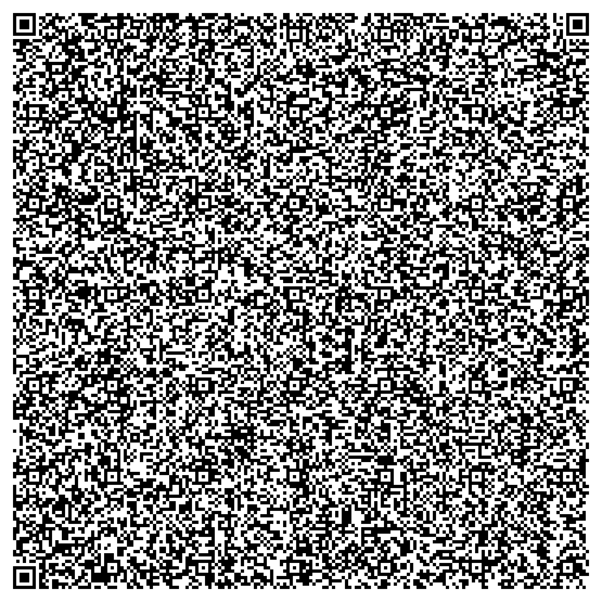
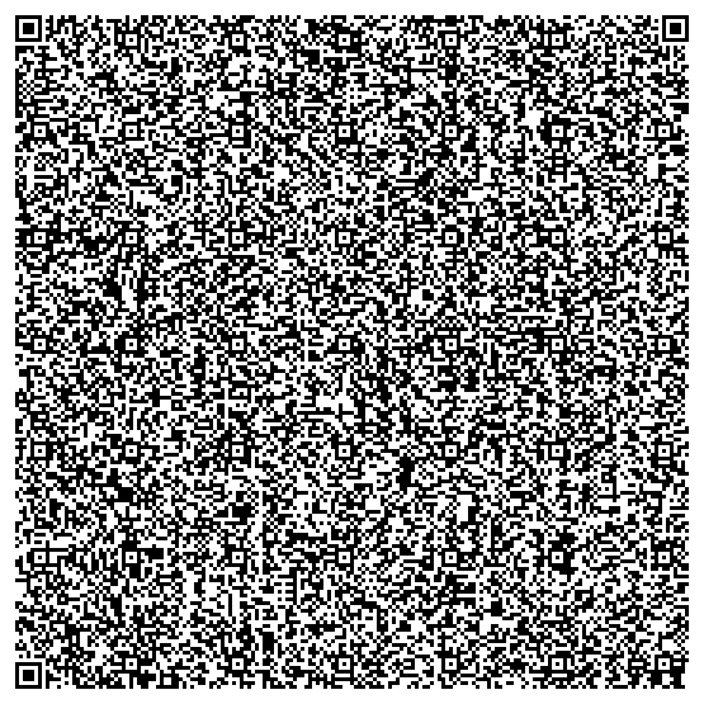

# Mandelbrot in assembly - small enough for a QR code

An interactive Mandelbrot set explorer written in MASM assembly (Windows, no C runtime). It exists in two versions, and the
whole program fits into a single QR code: scan it, copy the text, paste it into PowerShell, and the fractal opens.

| 32 bit | 64 bit (128 bit fixed point, deep zoom) |
|:---:|:---:|
|  |  |
| [`qr/mandelbrot32.ps1`](qr/mandelbrot32.ps1) | [`qr/mandelbrot64.ps1`](qr/mandelbrot64.ps1) |

**How to use a QR code:** scan it with any QR reader that can show the text (the text is a PowerShell script), copy the *whole*
text, paste it into a Windows PowerShell window and press Enter. The script unpacks the EXE to `%TEMP%` and starts it.
The `.ps1` files next to the images contain the same text if you prefer to copy it from here. How it works: [docs/qr-code.md](docs/qr-code.md).

## What it does

- Draws the Mandelbrot set into an 800x600 window, zoom with the **mouse wheel** around the mouse position.
- **32 bit:** 32 bit fixed point numbers (1 sign bit, 5 integer bits, 26 fraction bits).
- **64 bit:** 128 bit fixed point numbers (1 / 5 / 122 bits), so it can zoom much deeper. Extra controls, shown in the window title:
  keys **0-4** set the iteration count (10, 100, 1000, 10000, 100000), keys **5-9** set the pixel block size (1, 2, 4, 8, 16).
- No libraries besides `user32` and `gdi32`/`kernel32`; the EXEs are about 3 KB (32 bit) and 4.5 KB (64 bit).

## Build everything (one command)

Double-click **`build.cmd`** (or run `build.cmd 32`, `build.cmd 64`, `build.cmd both`). For the chosen version it

1. builds the EXE and shrinks it,
2. generates the QR code(s),
3. reads the QR code back and compares it with the script,
4. runs the script from the QR code, checks that the EXE starts, draws and reacts, and closes it again,
5. updates the QR images in [`qr/`](qr) (the ones shown above) and prints a result summary.

Options and details: [docs/tools.md](docs/tools.md).

### Requirements

- Windows 10/11 with **Visual Studio** (C++ workload with MASM: `MSBuild`, `ml.exe`, `ml64.exe`)
- 32 bit only: the **MASM32 SDK** in `C:\masm32` (`Windows.inc`, `user32.lib`, ...)
- **Python 3** with `pip install qrcode pillow pyzbar zopfli` (`zopfli` is optional, it saves about 40 bytes)
- a visible desktop for the automatic EXE test

## Repository layout

```
build.cmd              one-click build + QR code + test (calls tools/build.py)
README.md              this file
src/
  32bit/               Mandelbrot32.asm, .vcxproj, .sln   (open the .sln in Visual Studio to work on it)
  64bit/               Mandelbrot64.asm, .vcxproj, .sln, dos_stub.bin
tools/
  build.py             the automatic pipeline
  qr/qr_generator.py   EXE -> QR code (two variants)
  MiniPeLinker/        shrinks the 32 bit EXE (C#, built on demand)
  PostLinkStripper/    removes linker debug data from the 32 bit EXE (C#, built on demand)
  ExeSmokeTester/      screenshot regression test for an EXE (C#, built on demand)
  asm_size_report.py   shows where the code bytes go
qr/                    the published QR codes (png + script), updated by the build
docs/                  documentation (see below)
build/                 ALL build output, never committed. Same layout for both versions:
                         build/32bit/Mandelbrot32.exe   build/64bit/Mandelbrot64.exe   (final EXEs)
                         build/<bits>bit/obj/ (intermediate files)   build/<bits>bit/qr/ (generated QR codes)
                         build/tools/ (compiled helper tools)
```

## Documentation

| Document | Contents |
|---|---|
| [docs/architecture.md](docs/architecture.md) | how the programs work: fixed point math, zoom, controls, register conventions |
| [docs/size-optimization.md](docs/size-optimization.md) | how the EXEs were made tiny, measured sizes, techniques, open ideas |
| [docs/qr-code.md](docs/qr-code.md) | QR size budget, the two variants, how to change the texts |
| [docs/tools.md](docs/tools.md) | every tool and script in `tools/` |

## Conventions

- Everything (code comments, scripts, documentation) is written in English.
- `Mandelbrot64.asm` follows the structure and comments of `Mandelbrot32.asm`; differences are marked with `;64bit-specific`.
- Generated files only ever go to `build/` (and the published QR codes to `qr/`). No binaries are committed.
